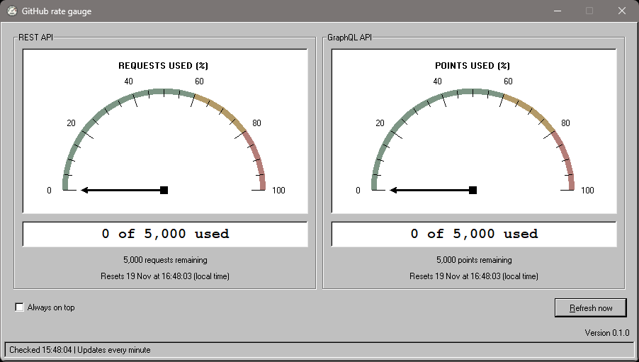

# GitHub Rate Gauge

A small Python/Tkinter desktop app with side-by-side gauges for GitHub core REST
API requests and GraphQL points. Each shows usage, the remaining allowance, and
its local reset time. Both refresh every minute from one quota check.
The app includes an Always on top checkbox.



Minimize the window to keep it running in the notification area near the clock.
Hover over its icon to see both quota readings and any refresh failure. Double-click
the icon, or choose **Open** from its right-click menu, to restore the window.
Choose **Quit** from that menu to exit. The window's close button also exits.
Windows may put the icon behind the hidden icons arrow.

One instance runs per Windows session. Launching the app again restores the
existing window, including when it is minimized to the tray.

The window position and **Always on top** preference are remembered in
`%LOCALAPPDATA%\GitHubRateGauge\settings.json`. Changes save automatically.
If your monitor layout changes, the saved position is adjusted to keep the
window on a visible screen.

Requires Python with Tkinter and GitHub CLI (`gh`), authenticated with the account
you want to monitor.

Double-click **Launch GitHub Rate Gauge.vbs** in Windows Explorer to launch
without a console window. **Launch GitHub Rate Gauge.cmd** also opens the hidden
launcher when double-clicked. Keep both launchers, the project files, and the
`assets` folder together.
On first launch, they create a private `.venv` using Windows Python 3.12 or later
with Tkinter and install the project and its Pillow and pystray dependencies
using `pyproject.toml` and public PyPI. An existing environment is updated when those dependencies
are missing.

The launchers use `gh` in your default WSL distribution. To select another
distribution, set the `GRG_WSL_DISTRO` environment variable to its name.
For visible startup diagnostics, run this from Command Prompt:

```bat
"Launch GitHub Rate Gauge.cmd" --diagnose
```

Run from this folder on Windows with:

```powershell
.venv\Scripts\python.exe -m pip install --index-url https://pypi.org/simple .
.venv\Scripts\python.exe rate_gauge.py
```

Run from WSL with:

```bash
wscript.exe 'C:\DATA\Private\GIT\github-rate-gauge\Launch GitHub Rate Gauge.vbs'
```

This launches the app hidden and returns control to the WSL terminal immediately.
To run attached to the terminal, use:

```bash
python3 /mnt/c/DATA/Private/GIT/github-rate-gauge/rate_gauge.py
```

When launched from WSL, the app opens using Windows Python so Always on top
works across Windows applications. It uses the project's Windows `.venv` when
present, or a Windows `python.exe` on the WSL PATH with the required dependencies
and Tkinter. Quota checks use `gh` in the WSL distribution
where you launched the app. When launched directly on Windows, quota checks
use the Windows `gh` login.

The current version appears at the bottom of the gauge and is read from
[VERSION](VERSION). See [CHANGELOG.md](CHANGELOG.md) for version history.
Package metadata also reads its version from `VERSION`. Installing the project
adds `.venv\Scripts\github-rate-gauge.exe` as a Windows GUI entry point.

To install development tools, format the Python files, and run lint checks:

```powershell
.venv\Scripts\python.exe -m pip install --index-url https://pypi.org/simple ".[dev]"
.venv\Scripts\python.exe -m black .
.venv\Scripts\python.exe -m ruff check .
```
